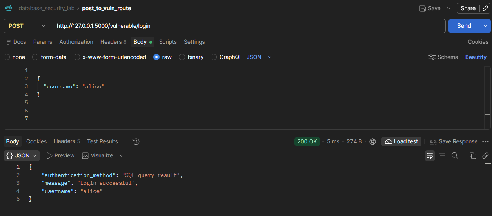
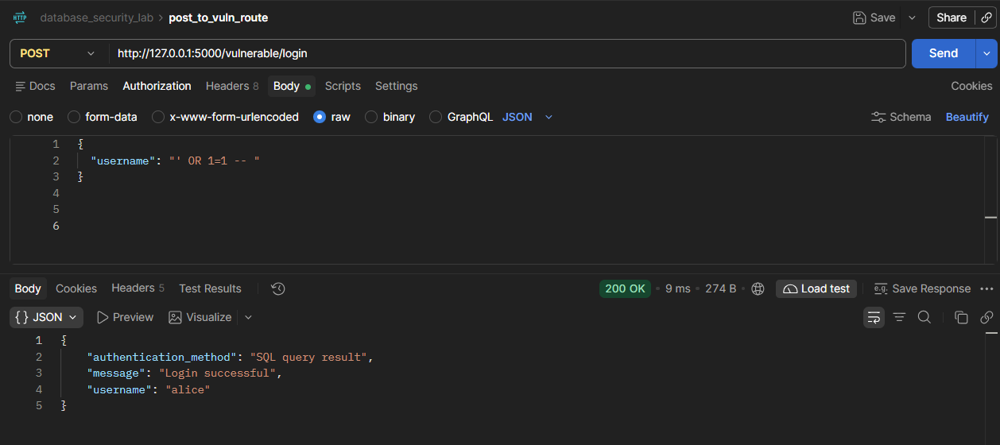
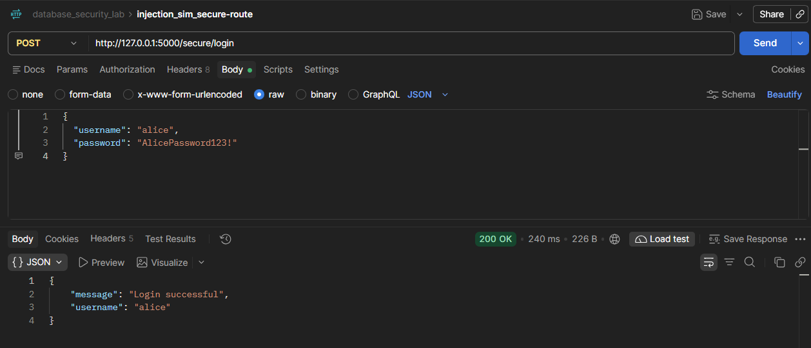
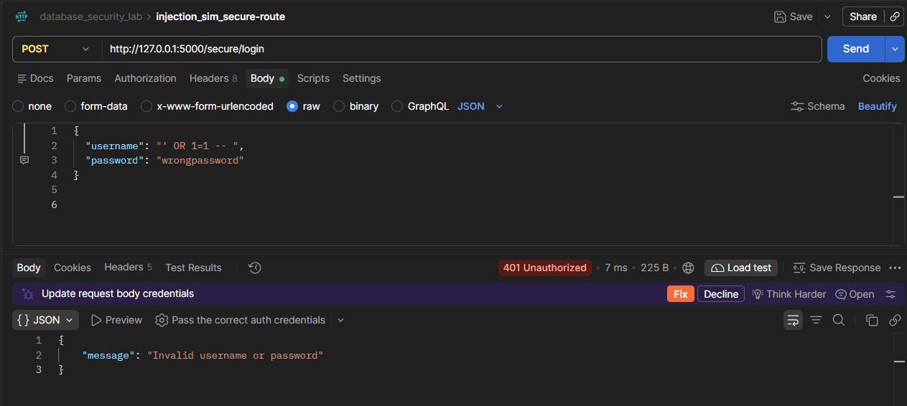
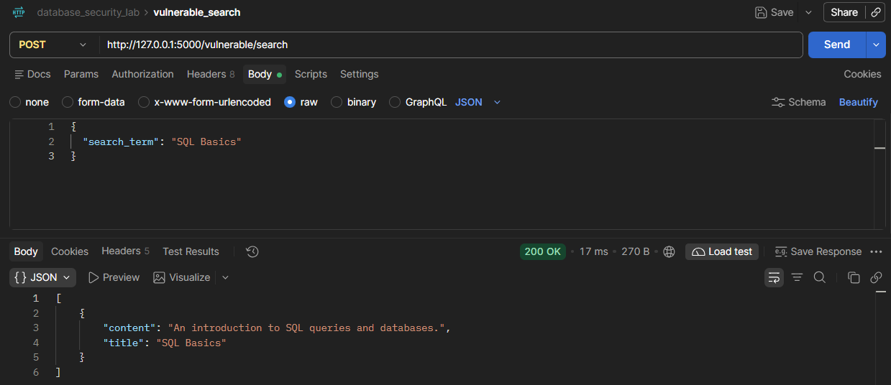
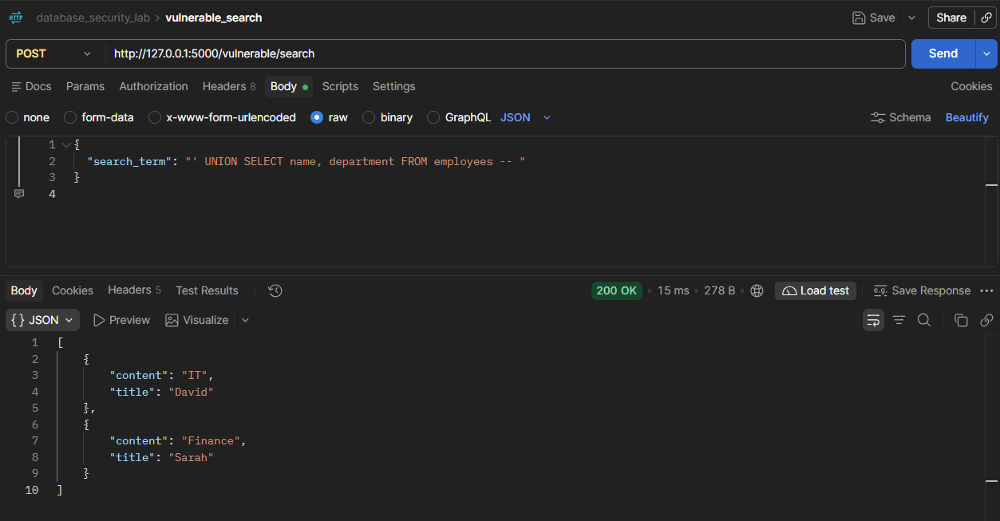
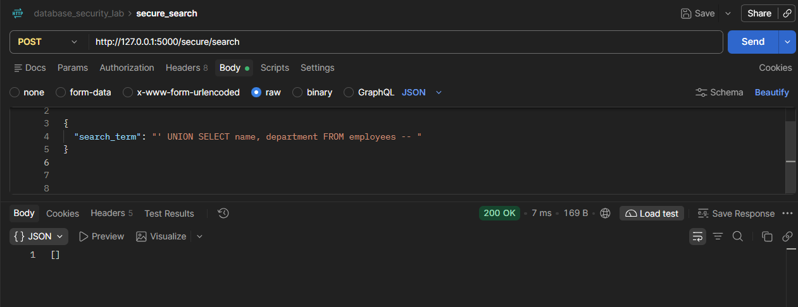
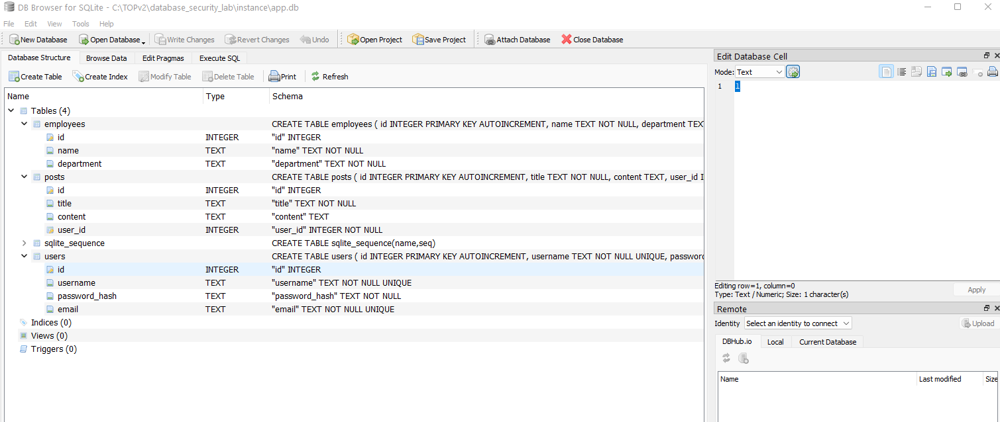

# SQL Injection Lab with Python, Flask and SQLite

## About the project

I created this project to understand how SQL injection works and how it can be prevented. Rather than just reading about the vulnerability, I wanted to build a small application, introduce the vulnerability myself, and test what happens when different SQL injection payloads are submitted.

The application has two main areas:

- Login authentication
- Searching for posts in a database

For each area, I created a vulnerable endpoint and a secure version. I then used Postman to send requests and compare their responses.

I also used DB Browser for SQLite to create and inspect the database tables and practise SQL queries.

## Technologies used

- Python
- Flask
- SQLite
- Postman
- DB Browser for SQLite

## Project structure

```text
database_security_lab/
│
├── instance/
│   └── app.db
│
├── screenshots/
│   ├── vulnerable-login.png
│   ├── vulnerable-login-sqli.png
│   ├── secure-login.png
│   ├── secure-login-sqli.png
│   ├── vulnerable-search.png
│   ├── union-sqli.png
│   ├── secure-search-union.png
│   └── database-tables.png
│
├── app.py
├── database.py
├── init_db.py
├── populate_posts.py
├── requirements.txt
└── .gitignore
```

## Database setup

The application uses SQLite and has three main tables:

**users**

Stores user account information, including usernames, email addresses and hashed passwords.

**posts**

Stores sample posts and links each post to a user through a foreign key.

**employees**

A separate table used during the UNION-based SQL injection exercise.

The database initialization script creates the tables and inserts three test accounts:

| Username | Email |
|---|---|
| alice | alice@example.com |
| bob | bob@example.com |
| charlie | charlie@example.com |

Charlie was included to practise LEFT JOIN queries and identify users who do not have any posts.

The `populate_posts.py` script adds three sample posts belonging to Alice and Bob.

The employees table contains two sample records:

| Name | Department |
|---|---|
| David | IT |
| Sarah | Finance |

## SQL exercises

Before working on the injection tests, I practised some SQL concepts using the sample database.

These included:

- INNER JOIN
- LEFT JOIN
- RIGHT JOIN
- Identifying records without matching records in another table using an anti-join.
- UNION and UNION ALL.

One thing I found useful was understanding the difference between JOIN and UNION. JOIN combines columns from related tables, while UNION combines the results of compatible SELECT statements.

## 1. SQL injection in login authentication

### Vulnerable endpoint

`POST /vulnerable/login`

The vulnerable endpoint builds an SQL query by directly inserting the username supplied by the user into the query string.

For a normal login request, I sent:

```json
{
    "username": "alice"
}
```

The application returned a successful login response.

I then tried the following input:

```json
{
    "username": "' OR 1=1 -- "
}
```

This changed the structure of the original SQL query. Instead of treating the supplied value as an ordinary username, the database interpreted part of it as SQL instructions.

The application returned a successful response because the modified query returned a user record.

**Note:** This endpoint was deliberately designed to demonstrate query manipulation. It does not perform password verification in the first place. The test shows how the application treats a returned database record as sufficient for login success.

### Secure endpoint

`POST /secure/login`

The secure version uses a parameterized SQL query. It also verifies the supplied password against the stored password hash.

For a valid login, I sent:

```json
{
    "username": "alice",
    "password": "AlicePassword123!"
}
```

The login was successful.

I then tested an incorrect password:

```json
{
    "username": "alice",
    "password": "wrongpassword"
}
```

The application rejected the request.

Finally, I tried the SQL injection payload:

```json
{
    "username": "' OR 1=1 -- ",
    "password": "wrongpassword"
}
```

The application returned an authentication error.

The difference is that the parameterized query treats the supplied username as a value rather than allowing it to change the SQL statement.

## 2. UNION-based SQL injection

### Vulnerable search endpoint

`POST /vulnerable/search`

This endpoint searches for posts using their titles.

For a normal search, I sent:

```json
{
    "search_term": "SQL Basics"
}
```

The application returned the matching post.

I then tested a UNION-based SQL injection payload:

```json
{
    "search_term": "' UNION SELECT name, department FROM employees -- "
}
```

The payload worked.

Although the endpoint was originally intended to search the `posts` table, I was able to retrieve records from the separate `employees` table through the same search endpoint.

The response contained:

- David — IT
- Sarah — Finance

This worked because the original query returned two columns, and the injected SELECT statement also returned two compatible columns.

The comment at the end of the payload prevented the remaining part of the original query from interfering with the injected statement.

### Secure search endpoint

`POST /secure/search`

I tested the same payload against the secure search endpoint:

```json
{
    "search_term": "' UNION SELECT name, department FROM employees -- "
}
```

This time, the application returned an empty result.

The parameterized query treated the entire payload as a search value instead of executing it as part of the SQL statement.

## Screenshots

I used Postman to test the endpoints and DB Browser for SQLite to inspect the database.

The screenshots below show the requests and responses from the practical exercises.

### Login tests









### Search tests







### Database



## Running the project locally

Clone the repository:

```bash
git clone <repository-url>
```

Move into the project directory:

```bash
cd database_security_lab
```

Create a virtual environment:

```bash
python -m venv .venv
```

Activate it on Windows:

```bash
.venv\Scripts\activate
```

Install the dependencies:

```bash
pip install -r requirements.txt
```

Initialize the database:

```bash
python init_db.py
```

Populate the posts table:

```bash
python populate_posts.py
```

Start the Flask application:

```bash
python app.py
```

The application will be available at:

`http://127.0.0.1:5000`

You can then use Postman to test the endpoints.

## What I learned

This exercise helped me understand SQL injection beyond just knowing what it means.

I got to see how directly inserting user input into an SQL query can change the query's behaviour. I also saw how a UNION injection can be used to retrieve information from another table when the query structure allows it.

Most importantly, testing the vulnerable and secure endpoints side by side made the purpose of parameterized queries much clearer.

I also got more practice working with SQLite, database relationships, joins and HTTP requests through Postman.

## Disclaimer

This project was created for learning and testing purposes. The vulnerable endpoints are intentionally insecure and should not be used in a real application.

All testing was performed against my own local database and application.